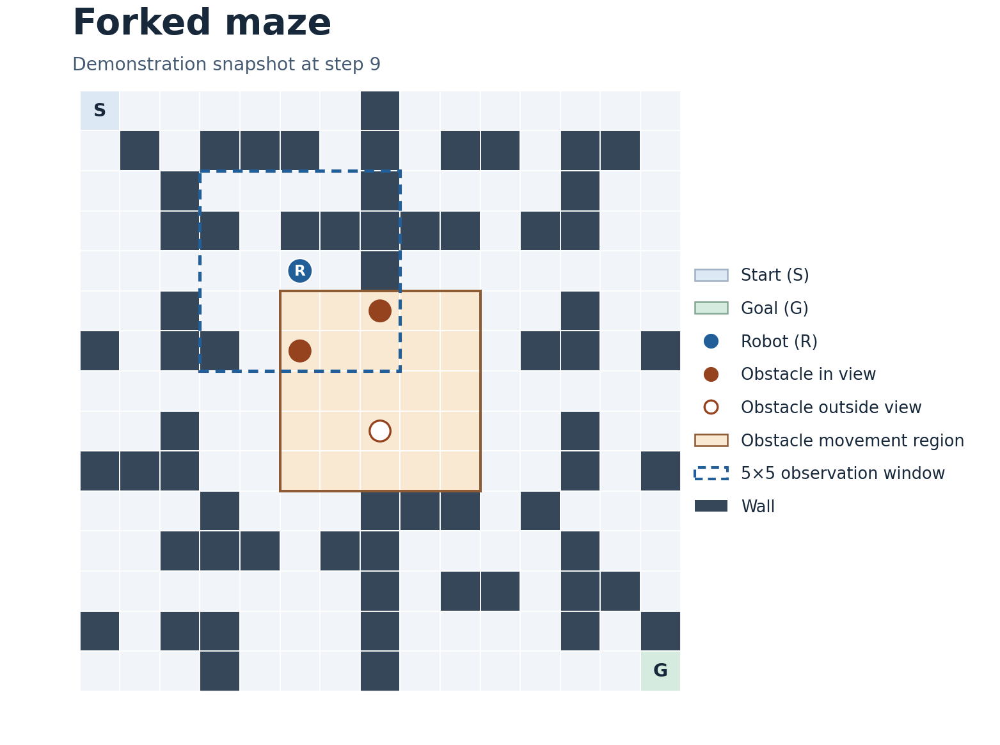
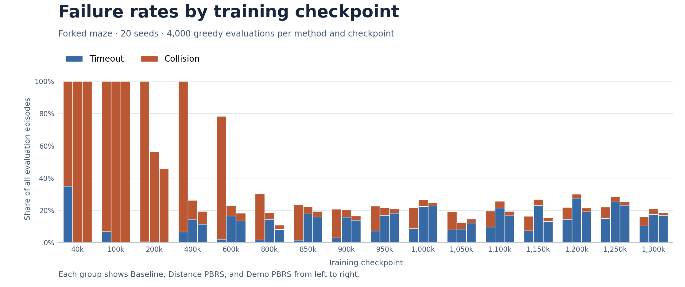

# Reward Misspecification in Tabular Reinforcement Learning

CSE 150A/250A team project. We compare three training rewards for tabular Q-learning in a delivery maze with moving obstacles and measure how shaping affects delivery, collision, and timeout rates.

## Run the experiment

```sh
git clone https://github.com/JungHyunAn/CSE-150A_Reward_Misspec.git
cd CSE-150A_Reward_Misspec
conda env create -f environment.yml
conda activate cse150a-gridworld
python -m reward_gridworld
```

The default Forked maze run trains seeds 0–19 for 1,300,000 actions each, with 200 matched greedy evaluation scenarios per seed at each checkpoint. The checkpoints are 40k, 100k, 200k, 400k, 600k, and every 50k from 800k to 1,300k. The default uses four workers. Use `--workers 1` for a serial run.

Quick smoke run:

```sh
python -m reward_gridworld --checkpoints 100 200 --seeds 0 --eval-episodes 5 --exploration-steps 200 --workers 1 --out runs/smoke
```

The default output directory is `runs/forked-maze/`. It contains per-seed counts (`seed-checkpoints.csv`), aggregated rates (`summary.csv`), settings (`config.json`), and the two figures linked below.

## Task and observation

Forked maze is a 15×15 grid with the start at the top left and the goal at the bottom right. Three obstacles move within the same central 5×5 region. Each obstacle stays with probability 0.5 and otherwise proposes a cardinal move within the region. Proposals into an occupied cell or a cell targeted by multiple obstacles are canceled.

### State and Q-table observation

Positions are zero-based $(\mathrm{row},\mathrm{col})$ pairs measured from the top-left corner. Rows increase downward and columns increase rightward. Let $p_t$ be the robot position, $b_{t,i}$ the position of obstacle $i$, and $h_t$ the number of actions already taken in the episode.

```math
\begin{aligned}
s_t &= (p_t,b_{t,1},b_{t,2},b_{t,3},h_t),\\
o_t &= (p_t,v_t).
\end{aligned}
```

The full state $s_t$ includes all obstacle positions and the episode clock, which the training loop tracks separately. The Q-table uses the partial observation $o_t$ and stores $p_t$ as a free-cell index. The tuple $v_t$ contains the offsets $b_{t,i}-p_t$ of visible obstacles, sorted by row and then column. An obstacle is visible when both absolute offsets are at most two cells. A view with zero visible obstacles has an empty tuple.



At step 9 of the fixed demonstration, the robot is at $(4,5)$ and the simulator has obstacles at $(8,7)$, $(5,7)$, and $(6,5)$. The observation is $o_9=((4,5),((1,2),(2,0)))$. The obstacle at $(8,7)$ is outside the view.

### Action space

Each observation has four Q-values, one per action. The selected action proposes a move from $(r,c)$ to $(r+\Delta r,c+\Delta c)$.

| Action ID | Direction | Displacement |
| --- | --- | --- |
| 0 | East (right) | `(0, +1)` |
| 1 | South (down) | `(+1, 0)` |
| 2 | West (left) | `(0, -1)` |
| 3 | North (up) | `(-1, 0)` |

An episode ends on delivery, collision, or timeout at 100 actions. Entering a wall, crossing the boundary, sharing an obstacle's destination cell, or swapping cells with an obstacle counts as a collision. The task reward charges 0.1 per action, adds 10 on delivery, and subtracts 10 on collision.

$$
r_t^{\mathrm{task}}
= -0.1 + 10\,\mathbf{1}_{\{\mathrm{delivery}\}} - 10\,\mathbf{1}_{\{\mathrm{collision}\}}.
$$

## Training rewards

Let $p$ be the robot position, $g$ the goal, and $d_{\mathrm{maze}}(p,q)$ the shortest path distance through the static maze. The fixed demonstration visits $p_0,\ldots,p_L$. The index $i_{\star}(p)$ selects the nearest demonstration cell by maze distance, with ties favoring the largest index.

```math
\begin{aligned}
\Phi_{\mathrm{baseline}}(p) &= 0,\\
\Phi_{\mathrm{distance}}(p) &= -\alpha\,d_{\mathrm{maze}}(p,g),\\
\Phi_{\mathrm{demo}}(p) &= -\alpha\left[(L-i_{\star}(p))
    + 2\,d_{\mathrm{maze}}\bigl(p,p_{i_{\star}(p)}\bigr)\right].
\end{aligned}
```

Both potential-based reward shaping (PBRS) methods use $\alpha=0.10$ and the same discount $\gamma=0.99$ as Q-learning. The learner receives

$$
r_t^{(m)} = r_t^{\mathrm{task}} + \gamma\Phi_m(p_{t+1}) - \Phi_m(p_t).
$$

For delivery, collision, and timeout, the successor potential is zero. Over a complete rollout the shaping terms telescope, so the shaped discounted return equals the task return minus the initial potential. All three methods start each evaluation at the same robot position.

## Q-learning update

Let $o_t$ denote the local observation and $d_t$ indicate episode termination. After each sampled transition, the learner uses

$$
y_t =
\begin{cases}
r_t^{(m)}, & d_t=1,\\
r_t^{(m)}+\gamma\max_{a'}Q_t(o_{t+1},a'), & d_t=0,
\end{cases}
\qquad
Q_{t+1}(o_t,a_t)=Q_t(o_t,a_t)+\eta\left[y_t-Q_t(o_t,a_t)\right].
$$

The learning rate is $\eta=0.20$. Training uses an $\epsilon$-greedy policy with $\epsilon$ decaying linearly from 1.0 to 0.05 over the first 320k updates and staying at 0.05 afterward. Evaluation freezes the table, uses greedy actions, and breaks ties in east, south, west, north order. Each method uses the same evaluation RNG seed for a given training seed and scenario index.

## Results



Each segment uses all 4,000 evaluation episodes for its method and checkpoint as the denominator. Timeout includes every episode that reaches the action limit without delivery or collision. The stack height is the total failure rate. A two-cell-loop timeout alternates between two distinct robot cells for the final 20 moves before a timeout.

| Method | Timeout | Collision | Total failure | Two-cell-loop timeout |
| --- | ---: | ---: | ---: | ---: |
| Baseline | 7.94% | 13.30% | 21.24% | 2.86% |
| Distance PBRS | 19.16% | 3.93% | 23.09% | 7.89% |
| Demo PBRS | 16.44% | 2.42% | 18.85% | 5.48% |

Values are averages over the 11 checkpoints from 800k to 1,300k and rounded independently. Both PBRS methods had fewer collisions and more timeouts than baseline over this interval. Paired 95% seed-bootstrap intervals for the difference in mean total failure compared with baseline included zero for both methods.

At 1,000k, two-cell loops accounted for 607 of Demo PBRS's 915 timeouts. At 1,200k, they accounted for 724 of Distance PBRS's 1,102 timeouts. Baseline rollouts also exhibited two-cell loops. The diagnostic describes behavior at the evaluated checkpoints.

[Loop-rate figure](results/forked-maze/two-cell-loop-timeouts.png) · [Checkpoint summaries](results/forked-maze/summary.csv) · [Per-seed counts](results/forked-maze/seed-checkpoints.csv) · [Experiment settings](results/forked-maze/config.json)

## Contributing

Create a branch for changes and open a pull request into `main`. Run the smoke command before opening a pull request. Keep other generated runs and local environments out of Git.
